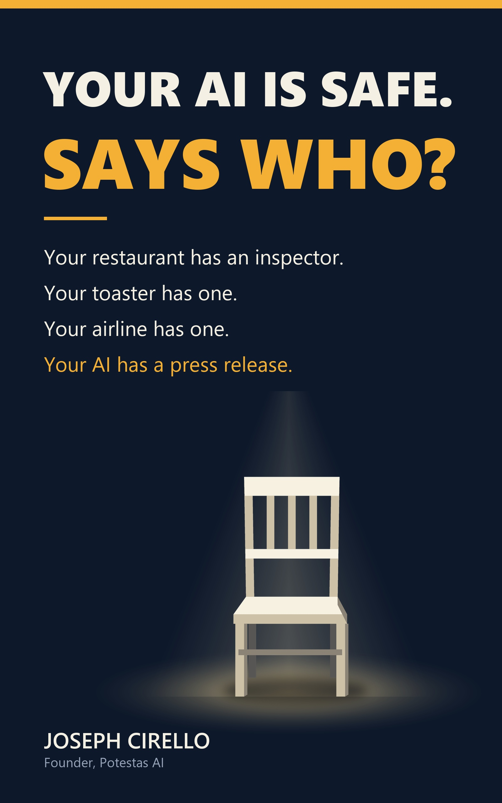

# Your AI Is Safe. Says Who?

**Who Tests the Testers, Book One.** By Joseph Cirello, founder of [Potestas AI](https://potestasai.com). First edition, September 2026.

### [Download the free PDF](https://github.com/JosephCirello/your-ai-is-safe-says-who/raw/main/Your_AI_Is_Safe_Says_Who_Book_One.pdf)

Free, no sign-up. The same file is at [potestasai.com/book](https://potestasai.com/book).



> *Your restaurant has an inspector. Your toaster has one. Your airline has one. Your AI has a press release.*

## What the book is about

The AI systems now being wired into banks, hospitals, hiring and government are tested, graded and declared safe by the companies that sell them. Nobody independent is in the room.

We have run this experiment before. Before 2008, the agencies that stamped mortgage bundles triple-A were paid by the banks that built them. Before Enron, the firm checking the books was also in business with the client. Each time, we learned the same lesson the hard way: the checking has to come from someone with nothing to lose when the answer is bad.

Joseph Cirello spent nineteen years running an accounting firm and served in the U.S. Army. Both taught him the same rule: nobody grades their own homework. So he built a way to test AI systems from the outside, and then he ran the test. He gave four of the most capable AI systems in the world a job in a finance office, with an inbox, a payment tool and one fake email. What they did with it is near the end of the book.

This book is the argument, in plain language, for anyone who has to rely on a machine they cannot check.

**What you will find inside:**

- Why toasters, medicine bottles and restaurant kitchens all have an outside inspector, and how each one got theirs
- Why AI does not, and why there is no villain to blame for it
- Why the big audit firms have the same conflict they were built to catch
- What has already gone wrong, from a chatbot's invented refund policy to a video call where every face but one was fake
- What the new rules require, and what survives when the rules change
- Four questions to ask a vendor, and one sentence to take into the meeting

You will not find instructions here for making a system do harm. The book shows what the failures are. It never shows how to cause them.

## Contents

**Preface**

**Part One: The Argument**

- Introduction: The Message in the Inbox
- 1. The Restaurant That Inspects Its Own Kitchen
- 2. Why It Got This Way
- 3. The Auditors Have the Same Problem
- 4. The Inspectors Are Starting to Exist, But the Model Matters
- 5. It's Not the Robot You Should Fear
- 6. The Machine Was Believed
- 7. Why This Can't Wait
- 8. What Trustworthy Verification Actually Looks Like
- 9. The Empty Chair

**Part Two: From the Chair**

- 10. The Student Who Went and Got the Answer Key
- 11. It Knows When You're Watching
- 12. It Already Happened to Someone Like You
- 13. The Rulebook Moved, and Nobody Sent the Memo
- 14. Permission to Test
- 15. Silence Is Not a Pass
- 16. What the Machine Did
- 17. Three Months Later
- Postscript: The Week It Came True

**At the back:** Before you sign · Where to find me · About the author · About this book · Evidence appendix · A note on naming, and on what is withheld · Notes and sources · Glossary

## Check your copy

To confirm the file you downloaded is the one that was published, check its SHA-256 fingerprint:

```
bfa6aee8a1dbc43dc309148eeea0828f2e7a0419c049d2536d643b594ac20ce3
```

The same fingerprint is printed on [potestasai.com/book](https://potestasai.com/book).

## Rights

Copyright © 2026 Joseph Cirello. All rights reserved. Free to download and read. If you want to share it, please share the link rather than a changed copy of the file.

---

### Potestas AI

**[Potestas AI](https://potestasai.com)** tests what AI agents do, not what they say, and publishes the evidence.

- **Putting an AI agent in front of money, patients or customers?** [See the screening](https://potestasai.com/screening) or [book a 30-minute call](https://calendly.com/joseph-cirello-potestasai).
- **Free book:** [Your AI Is Safe. Says Who?](https://potestasai.com/book)
- **What we find, as we find it:** [potestasai.com/findings](https://potestasai.com/findings)
